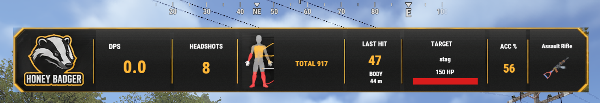

# HoneyBadger DPS Meter

A live on-screen damage band for Rust servers. One `.cs` file, free, MIT licensed. Runs under **Carbon** and **Oxide/uMod**.

Home and updates: **https://honeybadger.software**



*Real frame from a Carbon server, 1920x1080, 2026-10-27 ([full frame](screenshots/ingame-full.jpg)). `screenshots/band-art.png` shows the art pack on its own.*

## What players see

- **The band** (top centre, under the compass): badge, **DPS** over a rolling window, **HEADSHOTS**, body silhouette,
  **LAST HIT** with the body zone and range in metres, **TARGET** name with a live HP bar, **ACC %** (projectiles that
  landed over projectiles fired, pellets counted on both sides), and the weapon in hand with the game's own item icon.
- **Hit pop**: every landed hit flashes skull + damage + zone just left of the band for under a second. It never sits in
  the crosshair.
- **`/dps`** opens a settings menu: METER on/off, STYLE art/text, HIT POP on/off, RESET SESSION, CLOSE, with a live
  preview of the band. Every choice is remembered per player across relogs and plugin reloads.

## How the numbers are measured

Rust calls the damage hook **before** it applies a hit. The plugin remembers the target's health at that moment and reads
it again one server tick later. The difference is the damage that **actually landed**: armour, headshot multipliers, other
plugins and overkill are already accounted for. When a second hit reaches the same target in the same tick, the first
is settled the moment the second arrives and the last hit of the tick settles on the next tick, so every hit is credited
with exactly the health it took. Damage to yourself never counts.

## Install

1. Drop `HoneyBadgerDps.cs` into `oxide/plugins/` (Oxide) or `carbon/plugins/` (Carbon). It compiles on the spot.
2. Watch the console for `Loaded plugin HoneyBadger DPS Meter v1.0.2`.
3. Done. Everyone gets the band the next time they wake up. Change the defaults in the config if you want it off until a
   player opts in.

No dependencies. No other plugins required.

## Commands

| Chat | What it does |
|---|---|
| `/dps` | Opens the settings menu |
| `/dps on` / `/dps off` | Show or hide the meter |
| `/dps art` / `/dps text` | Painted band, or a plain text line (use text if a client cannot load images) |
| `/dps pop` / `/dps pop on` / `/dps pop off` | Hit pop next to the band |
| `/dps reset` | Clear this session's numbers |
| `/dps help` | The list above, in game |
| `/dps probe [https-url]` | Admins: draws one image top centre for 8 s to prove the client can load the art |

| Console (F1) | What it does |
|---|---|
| `hbdps.menu` | Opens the settings menu. Put it on a key: `bind f7 hbdps.menu` |
| `hbdps.toggle` | Flips the meter on/off. `bind f8 hbdps.toggle` |
| `hbdps.probe [https-url]` | Admin image probe |

`hbdps.set` and `hbdps.reset` are what the menu buttons run; they accept only `meter|style|pop` with `on|off|art|text`.

## Permissions

| Permission | Use |
|---|---|
| `honeybadgerdps.use` | Only checked when the config sets `Require the permission honeybadgerdps.use` to `true`. Admins always pass. |
| `honeybadgerdps.admin` | The image probe. Server admins (auth level) pass without it. |

Grant with `oxide.grant user <steamid64> honeybadgerdps.use` (Carbon accepts the same `oxide.*` commands).

## Configuration (`config/HoneyBadgerDps.json`)

```json
{
  "Meter": {
    "On by default for every player": true,
    "Require the permission honeybadgerdps.use": false,
    "DPS window in seconds": 5.0,
    "Refresh every N seconds": 0.5,
    "Count hits on NPCs (scientists)": true,
    "Count hits on animals": true,
    "Count hits on buildings and deployables": false,
    "Count hits on vehicles, helicopters and Bradley": true
  },
  "Art": {
    "Enabled (false = plain text meter for everyone)": true,
    "Image base URL (https, ends with /)": "https://honeybadger.software/assets/hud/v1/",
    "Image cache tag (change it after replacing the images)": "1",
    "Band distance from the top of the screen (1280x720 units)": 48.0,
    "Band scale": 1.0
  },
  "Hit pop": {
    "Enabled": true,
    "Seconds on screen": 0.9
  },
  "Chat hint the first time a player wakes up": true
}
```

- **DPS window**: the number on the band is damage landed in the last N seconds divided by N.
- **Count ...**: which targets feed the meter. Corpses never count. Buildings are off by default so base raiding does not
  read as combat; turn it on if you want it.
- **Band distance from the top**: 48 clears the compass and most status strips. Raise it if another plugin draws there.
- **Chat hint**: one line the first time a player wakes up each connection: `DPS meter is on. /dps opens its settings.`

## Hosting the art yourself

The band is four PNGs. By default every client downloads them straight from `honeybadger.software` (a static CDN, cached
by URL on the client). To serve them from your own host:

1. Copy `band_frame_cleaned_v3.png`, `badge.png`, `body_silhouette.png` and `hitpop_skull_cleaned.png` from
   `https://honeybadger.software/assets/hud/v1/` to any **https** host that serves them as `image/png` with no login and no
   redirect.
2. Set `Image base URL` to that folder, ending with `/`.
3. If you ever replace an image under the same name, change `Image cache tag` so clients fetch it again.

If a client cannot load images (corporate proxy, blocked host) the numbers still draw over a dark backing, and the player
can switch to `/dps text`. Admins can prove image loading with `/dps probe`.

## Language

All player-facing text is in `lang/en/HoneyBadgerDps.json` after the first load. Copy it to another language folder and
translate. The `Menu.*` keys are the menu labels; `TextMeter` and `Menu.PreviewText` take the numbers as `{0} {1} {2}`.

## Performance

The two damage hooks (`OnEntityTakeDamage`, `OnWeaponFired`) are subscribed only while at least one player has the meter
on screen. Inside the hook there is no LINQ, no reflection and no string formatting; the label texts are rebuilt on one
shared timer and a label is re-sent only when its text changed. Player choices are written to disk at most once every
three seconds, on server save and on unload.

## FAQ

- **The band shows numbers but no art.** That client could not download the PNGs. `/dps probe` as admin shows whether
  the badge loads; `/dps text` is the fallback for that player. Check the host serves `image/png` over https with no login.
- **DPS looks lower than my weapon's damage stat.** The band shows damage that *landed* after armour and multipliers, which
  is the honest number. Hitting a wall, a corpse or yourself never counts.
- **Can I move the band?** `Band distance from the top` and `Band scale` in the config. It is always centred.
- **Does it work with Carbon?** Yes. It was built and runs on a Carbon server; the Oxide build is checked against the
  official Oxide release before every version.

## Credits and licence

HoneyBadger Software, author line `Honeybadgermods`. Code: MIT licence, see `LICENSE`. Artwork: see `ART-LICENSE.md`; the band
images are licensed for use with this plugin, including self-hosted copies. Issues and ideas: https://honeybadger.software/contact.html
